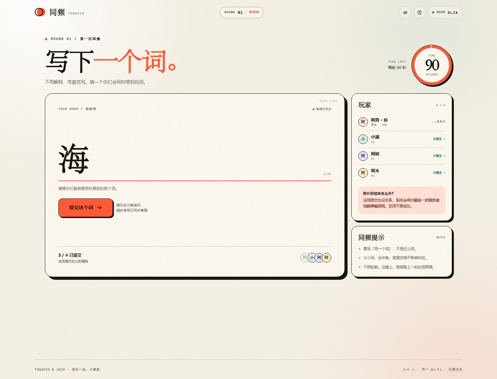

# 同频 · TONGPIN

> 想到一起，才算数。

一个多模式的实时联机小游戏。首页顶部可以直接切换三个模式：

| 模式 | 入口 | 人数 | 核心玩法 |
|---|---|---:|---|
| 同频猜词 | `/` | 2–4 人 | 各自写一个词，全员同词即成功 |
| 满分猜分 | `/guess` | 2–4 人 | 1 人描述，1–3 人猜目标分 |
| 危机公关 | `/crisis` | 2–6 人 | 全员写公关提案，匿名互评 |

---

## 危机公关

入口：`/crisis`

### 人数与目标

- **2–6 人**
- 每局 **3 轮**
- 没有品牌方，**所有人都是公关团队**
- 3 轮后累计分数最高者获胜

### 每轮流程

1. **公开危机**  
   系统发一张所有人都能看到的危机卡，目前有 **41 张原创危机**。  
   例如：奶茶品牌后厨被曝使用过期原料。

2. **写提案（不限时）**  
   每个人写一段公关提案（最多 400 字）。  
   提案要包含你的回应思路、声明和具体行动。所有人提交后自动进入下一步。

3. **查看提交状态**  
   提案页会显示每个人是「已提交」还是「写提案中」。  
   观战者也能看到进度，但不能提交。

4. **匿名展示与投票（不限时）**  
   所有提案同时亮出，先不显示作者。

   - **3 人及以上**：每人投 1 票给别人的提案，不能投自己；每票 1 分
   - **2 人局**：不投票，改为互评三项，每项 1–5 分：
     - 可信度
     - 可执行性
     - 创意

   投票/互评页会显示每个人是「已完成」还是「待投票 / 待互评」。

5. **揭晓与计分**
   - 3 人以上：票数就是本轮得分
   - 2 人：三项评分相加（3–15 分）就是本轮得分
   - 所有人完成后公布作者、得分和累计排名

6. **下一轮**
   房主点「下一轮」，进入下一个危机。  
   3 轮结束后显示最终排名。

### 观战、分享、导出

- 观战席：不占玩家位，可看危机、提案、提交/投票进度、结果，不能操作
- 一键复制：
  - 对局邀请
  - 观战邀请
  - 两个邀请一起复制
- 揭晓页可「导出对局数据」，复制所有已完成轮次
- 房主可以「重开本局」，保留玩家和观战者，清空分数和历史
- 猜分模式紫粉主题，危机公关蓝绿主题

### 卡住怎么办

危机公关**没有倒计时**，必须等所有人提交或投票。  
如果有人一直不动，房主可以点「重开本局」，回到大厅重新开始。

---

## 满分猜分

入口：`/guess`

### 人数与角色

- **2–4 人**
- 1 个描述者 + 1–3 个猜分者
- 每轮结束描述者可以继续，也可以指定下一位

### 准备阶段

房主先选择本局的满分对象：

- **满分朋友**（默认）
- **满分（自定义）**，括号里输入关键词，比如「同事」「男友」「妈妈」

这个对象在整局中保持不变；想换对象就重开回大厅。

### 一局怎么玩

1. 描述者私密抽一个 **0–10 分**，只有自己能看到。
2. 描述者补完一句话：

   > **TA 是一个满分（同事），但是（________）**

   描述者只填「但是」后面括号里的内容。

3. 描述者提交后，进入猜分环节。

4. 猜分者各自打 **0–10 分**，所有人提交后一起揭晓。

### 两种玩法

- **直接猜分**：描述 → 猜分 → 揭晓
- **问答模式**：描述 → 猜分者提问（40 秒，超时自动提交）→ 描述者回答（不限时）→ 猜分（不限时）→ 揭晓

### 反馈

对比猜分者的分数和描述者的目标分：

- 差 0 分：读心成功
- 差 1 分：心有灵犀
- 差 2 分：同频成功
- 超过 2 分：差一点

### 观战、分享、导出

- 观战链接不占玩家位
- 一键复制对局邀请 + 观战邀请
- 揭晓页可导出所有已完成轮次的数据
- 支持房主重开本局

---

## 同频猜词

入口：`/`

- 2–4 人
- 每人只写一个词，不看别人的词
- 全员提交或倒计时结束一起揭晓
- 所有人写出相同的非空词才算成功
- 没撞上就从上一轮的词继续联想，不限轮数
- 揭晓后全员点「继续」才进入下一轮
- 支持观战、点赞、默契奖励、词链复制、房主重开

<p align="center">
  
</p>

<p align="center">
  
  
</p>

## 快速开始

需要 Node.js 18+，项目零依赖。

```bash
cd tongpin
node server.js
```

或者双击 `start.cmd`（Windows）。

打开终端里打印的地址：

- 本机：`http://localhost:8787`
- 同一 Wi-Fi 的朋友：终端里打印的 `http://192.168.x.x:8787` 地址

朋友打开链接、输入房间码就能入座。最多 4 人，满 2 人开局。

如果朋友打不开局域网地址，检查两件事：大家连的是同一个 Wi-Fi；Windows 防火墙允许 Node.js 接收入站连接。

换端口：

```powershell
$env:PORT=8790; node server.js
```

## 跨城市 / 公网联机

不在同一个城市时，局域网地址无效，需要一个公网入口。

### Render 固定链接（推荐）

项目自带 `render.yaml`，可以免费部署到 Render：

1. 把项目上传到 GitHub 仓库（根目录要有 `render.yaml`）
2. 登录 [Render](https://render.com)，用 GitHub 授权
3. 点 **New → Blueprint**，选择这个仓库，点 **Apply**
4. 等部署完成，得到 `https://xxxx.onrender.com` 固定地址

Render 会自动提供 `RENDER_EXTERNAL_URL`，服务端会用它生成邀请链接，不需要手动设置 `PUBLIC_URL`。

免费实例闲置一段时间会休眠，打开链接等待几十秒即可唤醒；游戏进行中有请求，不会中途休眠。房间数据在内存里，服务重启后会清空。

### 临时公网链接（不推荐长期使用）

本机已经带 OpenSSH 时，可以用 localhost.run 开一个临时隧道：

```powershell
# 终端 1：启动游戏
node server.js

# 终端 2：开隧道（会打印 https://xxxx.lhr.life）
ssh -R 80:localhost:8787 nokey@localhost.run
```

拿到公网地址后，带上 `PUBLIC_URL` 重启游戏：

```powershell
$env:PUBLIC_URL="https://xxxx.lhr.life"
node server.js
```

然后打开公网地址创建房间，把大厅里的「公网邀请链接」发给朋友即可。

临时隧道适合一局游戏，进程停止或电脑休眠后链接会失效；免费隧道服务也可能主动更换域名。如果页面能打开、但操作时提示“连接不到服务器 / Failed to fetch”，通常就是隧道地址变了：查看隧道窗口最新打印的地址，重启服务并设置新的 `PUBLIC_URL` 即可。

需要长期固定入口，建议用 Cloudflare Tunnel 绑定自己的域名，或把项目部署到 Render / Railway / Fly.io 这类 Node.js 托管平台，并设置环境变量 `PUBLIC_URL=https://你的域名`。

> 公网房间靠四位房间码 + 玩家令牌区分身份。不要把这个地址当成私密网盘使用；房间数据只保存在内存里，重启即清空。

## 玩法

1. **2–4 人各自写一个词。** 不能讨论，也不能提示。
2. **全员提交或倒计时结束，一起揭晓。** 提交后不能修改；超时使用最后一次同步成功的草稿。
3. **所有人写出相同的非空词语，才算成功。** 没撞上，就从上一轮的词继续联想，不限轮数。
4. **揭晓后，全员点击「继续」，才开始下一轮。** 掉线的玩家不计入继续人数。

判定会忽略大小写、全半角和首尾空格，但不会把近义词当作同一个词。

### 观战席

大厅里可以复制「观战链接」，也可以让朋友从首页的「观战」入口输入房间码进入。

- 最多 20 位观战者，不占 2–4 个玩家名额
- 玩家开局后，观战者会自动进入观战画面，也可以中途加入
- 提交阶段看不到玩家的词，只能看到谁已提交；揭晓后能看到所有人的答案
- 观战者不能写词、不能提交、不能点继续
- 刷新页面会自动回到观战席

### 房间设置

房主可以在开局前把每轮时间设为 15 / 20 / 30 / 45 / 60 / 90 / 120 秒。开局后不能加入新玩家。

**15 / 20 秒极速模式**没有提交按钮：玩家只写草稿，倒计时结束后由服务器自动用最后一次同步成功的草稿揭晓，接口层也会拒绝手动提交。

## 特性

- 房间码 + 邀请链接，无需注册
- 服务端权威计时，超时自动揭晓
- 草稿自动同步，随时显示同步状态
- SSE 实时广播，断线自动重连
- 2–20 位观战者，不占玩家名额
- 写词时显示上一轮和上上轮，上上轮弱化展示
- 房主可以在对局底部重开本局，原班人马回到大厅
- 观战者在写词阶段可以查看完整词链
- 2 人或 3 人同词时显示「默契奖励」
- 写词阶段和揭晓阶段可以给词点赞，点赞后不能取消
- 同频后一键复制本局词链文本
- 一键复制「房间链接 + 观战链接」分享文案
- 刷新页面可以回到原来的座位或观战席
- 手机 / 平板响应式布局
- 词链历史、全员继续、同轮重开
- 零第三方依赖，单个 Node 进程即可运行

## 测试

```bash
node test/run.js
```

也可以用标准的 `node --test`（部分受限环境不允许测试运行器创建子进程）。

覆盖：

- 房间人数上限、重名、房主权限
- 提交前词义隐私、提交后锁定
- 全同词成功、大小写 / 全半角 / 空格归一化
- 超时使用草稿、全员继续、断线重连推进
- 观战者不占座位、提交前隐藏词义、不能操作
- 15 / 20 秒自动提交、上上轮弱化展示、合并分享文案
- 2/3 人同词的默契奖励、词链文本复制
- 词点赞、每人每词只能点一次、不能取消
- 房主重开本局、原班人马回到大厅
- 猜分模式：目标分隐私、1–3 位猜分者、0/1/2 分差、问答模式、换人、重开、观战和导出
- 危机公关：提案、匿名投票、2 人互评、观战、分享、导出和重开
- HTTP / SSE 端到端联机流程

## 结构

```text
tongpin/
├─ server.js          # HTTP、SSE、静态文件与计时扫描
├─ lib/game.js        # 猜词房间与回合状态机（无网络依赖）
├─ lib/guess.js       # 猜分模式状态机
├─ lib/crisis.js      # 危机公关状态机与危机卡
├─ public/
│  ├─ index.html
│  ├─ styles.css
│  ├─ app.js          # 猜词客户端，无构建步骤
│  ├─ guess.html
│  ├─ guess.css
│  ├─ guess.js        # 猜分客户端
│  ├─ crisis.html
│  ├─ crisis.css
│  └─ crisis.js       # 危机公关客户端
├─ test/
│  ├─ game.test.js
│  ├─ guess.test.js
│  ├─ crisis.test.js
│  └─ server.test.js
├─ start.cmd
├─ preview/           # 界面预览图
└─ package.json
```

## 说明

房间数据保存在内存里，服务进程重启后会清空。空闲 6 小时的房间会被自动回收。
