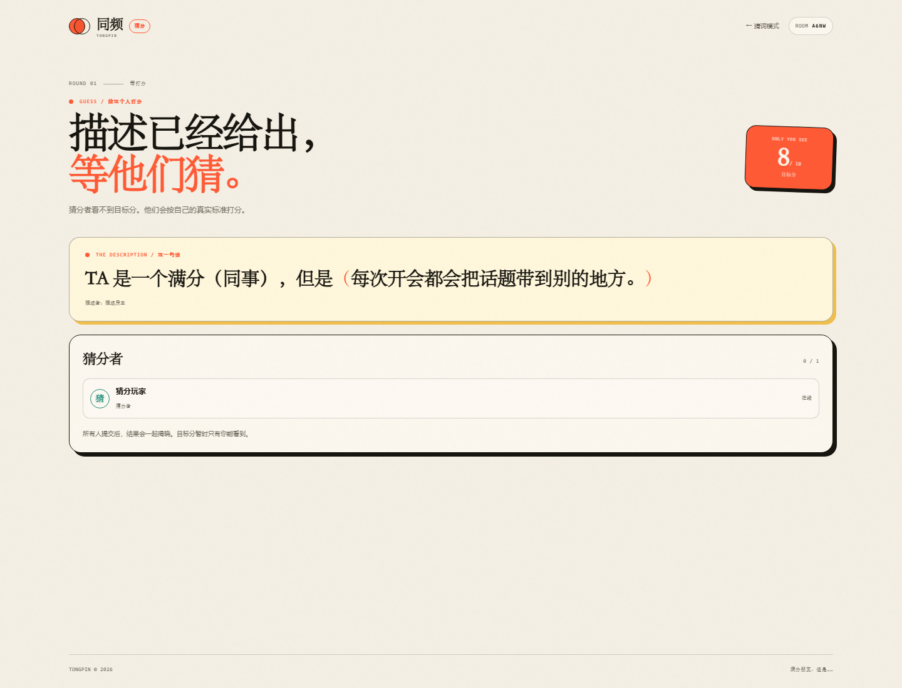
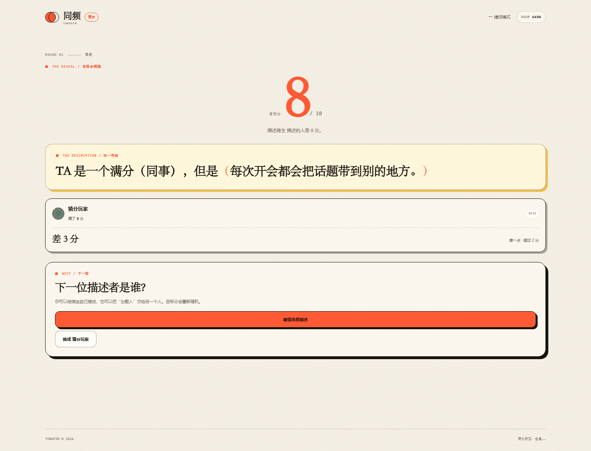
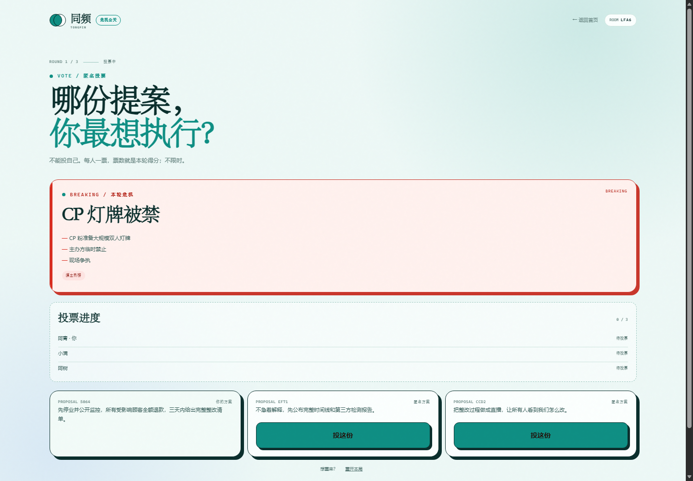
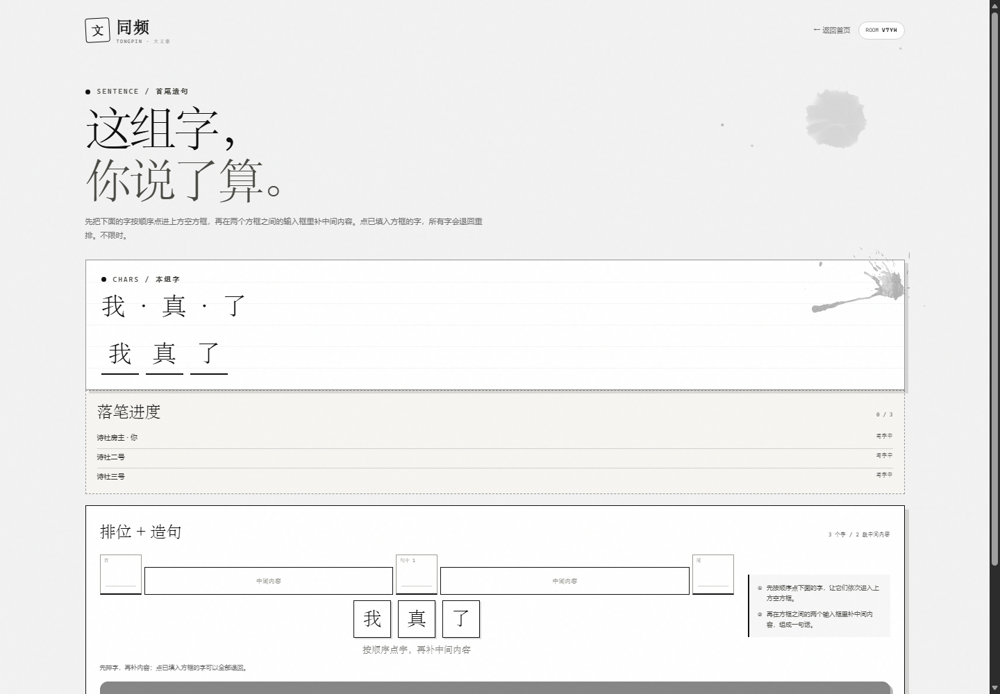

<p align="center">
  
</p>

<h1 align="center">同频 · TONGPIN</h1>

<p align="center"><strong>想到一起，才算数。</strong></p>

<p align="center">
  四个实时联机小游戏 · 2–6 人 · 无需注册 · 手机可玩
</p>

<p align="center">
  
  
  
  
</p>

> 一间房，几个人，四种完全不同的玩法。  
> 不用下载，不用注册，发个房间码就能开始。

---

## 目录

- [一分钟选模式](#一分钟选模式)
- [同频猜词](#一同频猜词)
- [满分猜分](#二满分猜分)
- [危机公关](#三危机公关)
- [大文豪](#四大文豪)
- [观战 / 分享 / 导出](#观战--分享--导出)
- [快速开始](#快速开始)
- [部署到公网](#部署到公网)
- [测试](#测试)
- [项目结构](#项目结构)

---

## 一分钟选模式

| 模式 | 人数 | 一句话 | 入口 |
|---|---:|---|---|
| **同频猜词** | 2–4 | 各写一个词，全员同词即成功 | `/` |
| **满分猜分** | 2–4 | 1 人描述，1–3 人猜目标分 | `/guess` |
| **危机公关** | 2–6 | 全员写公关提案，匿名投票 | `/crisis` |
| **大文豪** | 2–6 | 藏头诗 / 首尾造句，水墨风 | `/poem` |

> 首页顶部可以直接切换四个模式。  
> 右上角「更新日志」按版本记录了所有主要更新。  
> 双人局在「危机公关」和「大文豪」里都不计分。

---

## 一、同频猜词

<p align="center">
  
</p>

> **不用讨论，不用提示。看看你们是不是同一频道。**

| 人数 | 轮次 | 时间 | 胜负 |
|---|---:|---|---|
| 2–4 人 | 不限轮数 | 15–120 秒可选 | 全员同词即成功 |

### 怎么玩

1. 每个人私密写一个词。
2. 全员提交，或倒计时结束，一起揭晓。
3. 所有人写出**相同的非空词语**，才算成功。
4. 没撞上，就从上一轮的词继续联想，不限轮数。
5. 揭晓后全员点「继续」，才开始下一轮。

### 小提示

- 判定会忽略大小写、全半角和首尾空格。
- 近义词不算同一个词。
- 15 / 20 秒极速模式没有提交按钮，只写草稿，时间到自动揭晓。
- 写词时可以看到上一轮和上上轮，上上轮会弱化展示。
- 2 人或 3 人同词时，会显示「默契奖励」。
- 写词和揭晓阶段可以给词点赞，点赞后不能取消。

<details>
<summary><strong>进阶：房主设置与观战</strong></summary>

- 房主可以在开局前设置每轮 15 / 20 / 30 / 45 / 60 / 90 / 120 秒。
- 最多 20 位观战者，不占玩家位。
- 观战者在提交阶段只能看到谁已提交，看不到词。
- 刷新页面会自动回到原来的座位或观战席。

</details>

---

## 二、满分猜分

<p align="center">
  
  
</p>

> **TA 是一个满分对象，但是……**

| 人数 | 角色 | 时间 | 反馈 |
|---|---:|---|---|
| 2–4 人 | 1 个描述者 + 1–3 个猜分者 | 问答 40 秒 | 0 / 1 / 2 分差 |

### 怎么玩

1. 房主选择本局的满分对象：
   - **满分朋友**（默认）
   - **满分（自定义）**：比如「同事」「男友」「妈妈」
2. 描述者私密抽一个 **0–10 分**。
3. 描述者补完一句话：

   > **TA 是一个满分（同事），但是（________）**

4. 猜分者各自打 **0–10 分**。
5. 所有人提交后一起揭晓。

### 两种猜分方式

| 方式 | 流程 |
|---|---|
| **直接猜分** | 描述 → 猜分 → 揭晓 |
| **问答模式** | 描述 → 猜分者提问（40 秒）→ 描述者回答（不限时）→ 猜分（不限时）→ 揭晓 |

### 反馈

| 分差 | 反馈 |
|---:|---|
| 0 | 读心成功 |
| 1 | 心有灵犀 |
| 2 | 同频成功 |
| 超过 2 | 差一点 |

<details>
<summary><strong>进阶：换人、观战与导出</strong></summary>

- 每轮结束，描述者可以继续，也可以指定下一位。
- 支持一键复制对局邀请码 + 观战邀请码。
- 揭晓页可以复制本局所有已完成轮次的数据。
- 支持房主重开，原班人马回到大厅。

</details>

---

## 三、危机公关

<p align="center">
  
</p>

> **先别解释，先提案。**

| 人数 | 轮次 | 时间 | 计分 |
|---|---:|---|---|
| 2–6 人 | 3 轮 | 不限时 | 3 人以上投票；2 人不计分 |

### 怎么玩

1. 系统发一张公共危机卡。
2. 每个人写**一段公关提案**（最多 400 字），不限时。
3. 页面显示每个人是「已提交」还是「写提案中」。
4. 所有人提交后，匿名展示所有提案。
5. **3 人及以上**：每人投 1 票给别人的提案，不能投自己。
6. **2 人局**：不投票、不打分，双方提交后直接互相看提案。
7. 所有人完成后揭晓作者；3 人以上按票数累计，3 轮后排名。

### 危机卡

- 共 **100 张**娱乐新闻改编卡
- 覆盖：红毯、影视、综艺、男团女团、CP、粉丝、代言、演唱会、短剧
- 所有人名、品牌、作品名均已隐去
- 每轮随机，3 轮不重复

### 房主功能

- 写提案前、还没人提交时，可以反复点「换一个危机」
- 可以重开本局
- 可以复制对局邀请 + 观战邀请

> 2 人局没有输赢，重点是互相看提案。  
> 3 人以上才有投票和累计排名。

<details>
<summary><strong>进阶：双人局与观战</strong></summary>

- 双人局不显示分数、不排名。
- 观战者能看到危机、提案、提交/投票进度和结果，但不能操作。
- 揭晓页可以导出所有已完成轮次。

</details>

---

## 四、大文豪

<p align="center">
  
</p>

> **一本正经，胡说八道。**

| 人数 | 轮次 | 主题 | 计分 |
|---|---:|---|---|
| 2–6 人 | 3 轮 | 黑白灰水墨风 | 3 人以上投票；2 人不计分 |

大文豪有两种玩法，房主在大厅选择。

### 玩法 A：藏头诗

1. 系统给一个 2–4 字藏头词。
2. 几个字就写几行，每行第一个字固定。
3. **不限时**。
4. 所有人提交后匿名展示。
5. 3 人以上每人投一票给最好笑的一首。
6. 本轮第一名指定下一轮藏头词。
7. **2 人局**：不计分；第二轮随机一位出题，第三轮换另一位。

### 玩法 B：首尾造句

<p align="center">
  
</p>

1. 每人先出 **1 个字**。
2. 出字阶段 **限时 20 秒**，输入会自动存档。  
   超时没提交就用最后一次存档；完全没填则系统代填一个真实汉字，并在页面上提示。
3. 所有人出完后，公开这组字。
4. 每个人各自把字排到「首 / 句中 / 尾」。
5. 界面按「空方框 → 输入框 → 空方框 → 输入框 → 空方框」排列，下面才是这组字。  
   按顺序点字，先点的字进第一个空方框，再点进第二个。
6. 点已经放进方框里的字，所有字退回，重新排。
7. 在方框之间的输入框里补中间内容；中间内容可以留空，字全部放进方框即可提交。留空提交时会二次确认。**造句不限时**。
8. 3 人以上匿名投票；2 人局不计分。

### 位置数量

| 人数 | 位置 |
|---:|---|
| 2 | 首、尾 |
| 3 | 首、句中、尾 |
| 4 | 首、句中、句中、尾 |
| 5 | 首、句中、句中、句中、尾 |
| 6 | 首、句中、句中、句中、句中、尾 |

### 计分

- **3 人以上**：每轮票数 = 本轮得分，3 轮累计。
- **2 人**：不投票、不计分，只互相看作品。
- 平票时，系统随机选一位接龙。

---

## 观战 / 分享 / 导出

四个模式都支持：

- **观战席**：不占玩家位，可看进度和结果，不能操作
- **房间码**：四位字母/数字
- **邀请链接**：发给朋友直接入座
- **观战链接**：发给不想玩的人
- **一键复制邀请 + 观战**
- **刷新回到原身份**
- **房主重开**

其中：

- 猜分、危机公关、大文豪支持**导出对局数据**
- 同频猜词支持**复制词链**
- 危机公关的导出是「轮次 + 提案 + 得票/排名」的排版文本
- 大文豪的导出是「藏头词/本组字 + 每人作品 + 票数」

---

## 快速开始

需要 **Node.js 18+**，零第三方依赖。

```bash
git clone <your-repo-url>
cd tongpin
node server.js
```

Windows 也可以双击：

```text
start.cmd
```

打开终端里打印的地址：

```text
http://localhost:8787
```

同一 Wi-Fi 的朋友，用终端里打印的局域网地址加入。

---

## 部署到公网

推荐 Render：

1. 把项目推到 GitHub。
2. Render 新建 **Web Service**，连接仓库。
3. Build Command 留空。
4. Start Command：

```text
node server.js
```

5. 环境变量：

```text
PUBLIC_URL=https://你的域名
```

6. 部署完成后打开：

```text
https://你的域名/api/health
```

看到：

```json
{"ok":true,"rooms":0}
```

就说明服务正常。

> 房间数据只保存在内存里，服务重启即清空。  
> 房间码 + 玩家令牌区分身份，不要把这个地址当私密网盘使用。

---

## 测试

```bash
node test/run.js
```

当前覆盖：

- 猜词：人数、隐私、锁定、同词、超时草稿、观战、重开、点赞、默契奖励
- 猜分：目标分隐私、0/1/2 分差、问答模式、换人、观战、导出
- 危机公关：100 张卡、3 轮、匿名投票、2 人不计分、换危机、观战、重开
- 大文豪：藏头诗、首尾造句、2 人不计分、20 秒出字、轮流出题
- HTTP / SSE 联机流程

---

## 项目结构

```text
tongpin/
├─ server.js              # HTTP、SSE、静态文件与计时扫描
├─ lib/
│  ├─ game.js             # 同频猜词
│  ├─ guess.js            # 满分猜分
│  ├─ crisis.js           # 危机公关 + 100 张危机卡
│  └─ poem.js             # 大文豪：藏头诗 + 首尾造句
├─ public/
│  ├─ index.html
│  ├─ styles.css
│  ├─ app.js
│  ├─ guess.html / guess.css / guess.js
│  ├─ crisis.html / crisis.css / crisis.js
│  ├─ poem.html / poem.css / poem.js
│  └─ updates.html / updates.css   # 按版本展示的更新日志
├─ test/
│  ├─ game.test.js
│  ├─ guess.test.js
│  ├─ crisis.test.js
│  ├─ poem.test.js
│  └─ server.test.js
├─ preview/               # 界面预览图
├─ start.cmd
└─ package.json
```

---

<p align="center">
  <strong>想到一起，才算数。</strong><br />
  <sub>TONGPIN © 2026</sub>
</p>


